# Cowork ↔ editor agent (Cursor / VS Code) ↔ GitHub ↔ Anvil — Workflow Guide

How Production Control v2.0 (and, once cloned the same way, every other Titan Anvil app)
is designed, built, deployed and released. Supersedes the Antigravity/Gemini guide.

**Roles**

| Who | Does |
|---|---|
| **Claude Cowork** (strategic partner) | Strategy, UI direction, data questions (Nexus MCP), writes `SPEC.md` into the repo, reviews the resulting commit diff. Project memory lives here. |
| **Editor agent** (hands) — Cursor Agent mode, or VS Code (Copilot agent / Cline / Claude Code / Codex); any model | Reads `SPEC.md`, edits code, `py_compile`, commits, pushes. Governed by `AGENTS.md` (pointed to by `.cursor/rules/anvil.mdc`, `CLAUDE.md`, `.github/copilot-instructions.md`). |
| **GitHub** `origin` | Hub. `master` = editing branch, `published` = live. |
| **Anvil Cloud Editor** | Two-way sync with `origin/master`. Designer edits become "Edited <form>" commits. Green Run tests `master`. |
| **Dave** | Smoke test in Anvil, decide when `master` → `published`. |

---

## Layout

```
D:\cowork\projects\all_apps\                 <- Cowork connected folder
  current_anvil_code\
    dw_Production Control v2.0\              <- the editor opens THIS folder (one git repo)
      AGENTS.md                              <- standing rules, every editor agent (single source)
      .cursor\rules\anvil.mdc  CLAUDE.md  .github\copilot-instructions.md   <- pointers to AGENTS.md
      SPEC.md                                <- gitignored handoff from Cowork
      WORKFLOW.md                            <- this file
      client_code\  server_code\  theme\  anvil.yaml
```

Remote: `https://github.com/dwhritenour/production_control-v2.0.git`

---

## The loop (flowchart)

```mermaid
flowchart TD
    A([Idea / problem]) --> B[Cowork: discuss, decide<br/>strategy, UI, data]
    B --> C[Cowork writes SPEC.md<br/>into the repo root]
    C --> D["You → Cursor:<br/>'Read SPEC.md and implement it.'"]
    D --> E[Cursor: git pull origin master]
    E --> F{All SPEC references<br/>resolve?}
    F -- no --> G[Cursor reports,<br/>does NOT work around] --> B
    F -- yes --> H[Cursor edits code<br/>py_compile · git add -A<br/>commit · push origin master]
    H --> I[Anvil ingests origin/master<br/>seconds to a few minutes]
    I --> J[Cowork reviews the commit diff<br/>against SPEC.md]
    J --> K[You: green Run in Anvil editor<br/>smoke test on master]
    K --> L{Pass?}
    L -- no --> M["Cursor: 'git revert HEAD and push'<br/>(or fix forward via new SPEC)"] --> B
    L -- yes --> N{Ready for<br/>shop floor?}
    N -- not yet --> A
    N -- yes --> O["Cursor: 'Release master to published'<br/>= git push origin master:published --force-with-lease"]
    O --> P([Live app updated])

    subgraph Anvil designer edits
        Q[You change layout in Anvil designer] --> R["Anvil auto-commits<br/>'Edited <form>' to origin/master"]
        R -.-> E
    end
```



---

## Daily prompts (copy/paste into the editor agent)

| Situation | Prompt to the agent |
|---|---|
| Implement a spec | `Read SPEC.md and implement it.` |
| Small direct change (no spec) | `<describe change>, then commit on master and push to origin master.` |
| Sync after designer edits | `Pull origin master.` |
| Undo last push (keeps history) | `Revert the last commit on master with git revert HEAD --no-edit and push.` |
| Backup before a big refactor | `Create and push tag backup-YYYY-MM-DD-<reason> on the current commit.` |
| Release to live users | `Release master to published.` |
| Emergency: master is a mess | `Fetch origin, hard-reset master to origin/published, force-push master.` (Cursor will ask to confirm — this discards master's unreleased commits.) |

The agent's reply format (per the rules): files changed, commit hash, anything unresolved,
smoke-test steps. Paste the hash to Cowork; Cowork diffs the commit from the connected folder.

---

## Rules of the road

1. **Pull before edit, always.** Designer edits live only in `origin/master` until pulled.
2. **`published` is sacred.** Only "Release master to published" moves it, with `--force-with-lease`.
3. **`SPEC.md` never commits** (gitignored). `WORKFLOW.md` and `.cursor/` do — they travel with the repo.
4. **YAML is designer territory.** `form_template.yaml` / `anvil.yaml` edits only when a spec names the exact lines; structure preserved verbatim.
5. **No DDL from the app repo.** Schema changes go through `migrations/` with Dave as gatekeeper.
6. **Merge commits after a pull are normal** — Anvil committed while Cursor had local commits. Nothing to fix.
7. **If Anvil's Version History shows `origin/master` ahead of `master`** (you had the editor open with uncommitted cursor edits during a push): right-click the top `origin/master` commit → *Reset master branch to here* (or *Merge* to keep your editor edits).

---

## Setting up another app the same way

1. Confirm the app's Anvil ↔ GitHub link (Anvil: Version History → linked repo) and that a `published` branch exists and is pinned in **Publish**.
2. Clone into `current_anvil_code\dw_<App Name>\` (or use the existing clone).
3. In Cursor's terminal: `git config core.autocrlf true` then `git add --renormalize .`
4. Copy `AGENTS.md`, the three pointer files (`.cursor\rules\anvil.mdc`, `CLAUDE.md`, `.github\copilot-instructions.md`), `WORKFLOW.md`, and the `SPEC.md` line of `.gitignore` from this repo; adjust the app name in the AGENTS.md header.
5. Pipe test: one-line label change → commit → push → confirm in Anvil's Version History → revert.
6. Optional: open all apps at once with a multi-root workspace (`File → Add Folder to Workspace…`, save as `titan-apps.code-workspace` in `current_anvil_code\`). Each folder stays its own repo; commits/pushes are per app.

---

## Setting up a new computer (learned 2026-10-19 on BigAlien)

The D: drive carries the clones between machines, but the machine itself needs tooling and
credentials before the editor agent can work. Do these once, in a standalone PowerShell:

1. `winget install --id Git.Git -e --source winget` (no Git = the agent silently falls back to
   Copilot's bundled copy and then hangs on the credential prompt).
2. `git config --global user.name "<name>"`, `git config --global user.email "<email>"`,
   `git config --global core.autocrlf true`.
3. `winget install --id Python.Python.3.12 -e`, then Settings -> Apps -> Advanced app settings ->
   App execution aliases: turn OFF `python.exe` and `python3.exe` (the Store stubs). A fresh
   window's `python --version` must print 3.12.x or `py_compile` cannot run.
4. In the repo folder run `git pull --ff-only origin master` BY HAND once. It opens the GitHub
   browser sign-in; after that the token is in Windows Credential Manager and the agent's pulls
   and pushes are silent.
5. `git status --short` should list only what Cowork has placed. A wall of modified files means
   the clone predates `core.autocrlf` - tell Cowork before letting any agent commit.
6. In the editor, turn on terminal auto-approval for `git`, `python`, `py`, `Get-ChildItem`
   and `file` (VS Code: `chat.tools.terminal.autoApprove`), or every run pauses at its first
   command.
7. In Cowork, grant the session access to `D:\cowork\projects\all_apps` (it is a new
   computer, so the previous grant does not carry over). If Cowork reports it has file access
   but no shell, restart the Claude desktop app once so it can provision its local VM.

## Editor notes

**VS Code agents** read `AGENTS.md` (Copilot also reads `.github/copilot-instructions.md`, Claude Code reads `CLAUDE.md`). Turn on auto-approval for terminal commands in the agent you use, or the run stalls at the first `py_compile` / git step. Agents that do not run commands automatically leave files written but nothing committed; `git status` shows what landed.

### About Cursor's "Review" panel

The box at the bottom of the Cursor chat listing files with `+n −m` and a **Review** button is
Cursor's running tally of files the agent touched *in that chat session*. It is not a pending
action and not a git state: the changes are already on disk and (if the agent pushed) already
in GitHub/Anvil. **Review** opens a side-by-side diff for inspection. It clears when you start
a new chat. Safe to ignore; useful to glance at before saying "push" on a bigger change.
